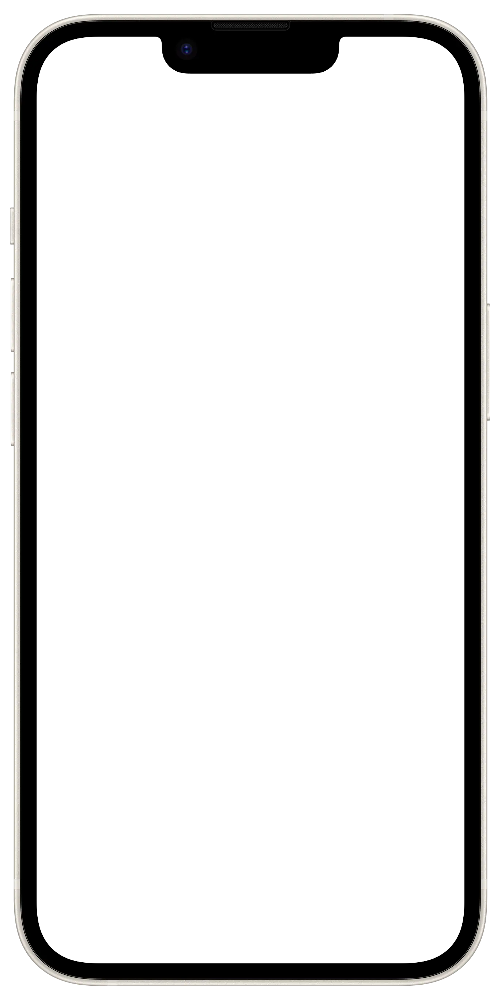

<div align="center">

  # 🔥 Tinder Swipe · Edición Premium
  
  **Un clon web interactivo de Tinder desarrollado con JavaScript puro, físicas 3D reactivas y síntesis de audio procedural.**

  [](https://developer.mozilla.org/es/docs/Web/JavaScript)
  [](https://developer.mozilla.org/es/docs/Web/HTML)
  [](https://developer.mozilla.org/es/docs/Web/CSS)
  [](https://developer.mozilla.org/es/docs/Web/API/Web_Audio_API)
  [](#)
  [](#licencia)

  <br />

  <p align="center">
    <a href="#-demostración">Ver Demo</a> •
    <a href="#-características">Características</a> •
    <a href="#-atajos-de-teclado">Atajos</a> •
    <a href="#-instalación-y-uso">Instalación</a> •
    <a href="#-arquitectura-técnica">Arquitectura</a> •
    <a href="#-autor">Autor</a>
  </p>

</div>

---

## 📖 Tabla de Contenidos

- [Descripción](#-descripción)
- [Demostración](#-demostración)
- [Características Principales](#-características-principales)
- [Atajos de Teclado (Escritorio)](#-atajos-de-teclado-escritorio)
- [Instalación y Uso](#-instalación-y-uso)
- [Estructura del Proyecto](#-estructura-del-proyecto)
- [Arquitectura Técnica](#-arquitectura-técnica)
- [Rendimiento y Buenas Prácticas](#-rendimiento-y-buenas-prácticas)
- [Autor](#-autor)
- [Licencia](#-licencia)

---

## 📱 Descripción

**Tinder Swipe (Edición Premium)** es el primer proyecto de la serie *100 proyectos JS*. Simula a nivel de producción la experiencia de usuario móvil de Tinder dentro de un marco fotorrealista de smartphone.

El proyecto está construido desde cero en **Vanilla JavaScript**, sin frameworks pesados, bibliotecas externas ni empaquetadores, demostrando el poder del DOM moderno, las APIs nativas del navegador (HTML5 Canvas y Web Audio API) y el renderizado acelerado por GPU.

---

## 🎬 Demostración

<div align="center">
  
  <p><em>Interfaz interactiva con marco de smartphone, Dynamic Island y baraja reactiva.</em></p>
</div>

---

## ✨ Características Principales

| Característica | Descripción |
| :--- | :--- |
| **Física de Arrastre 3D** | Arrastre fluido táctil y de ratón con inclinación tridimensional (`perspective` y `rotate3d`), resistencia dinámica y rebote elástico. |
| **Sintetizador Procedural** | Efectos de sonido en tiempo real generados por software con **Web Audio API** (cero archivos `.mp3` o `.wav` descargados). |
| **Motor de Partículas Canvas** | Sistema de confeti, chispas doradas, estrellas y corazones flotantes procesados en `<canvas>` a 60 FPS. |
| **Navegación por Historias** | Múltiples fotos por perfil con barras de estado individuales (*story-bars*), navegables tocando los extremos de la tarjeta. |
| **Dynamic Island Funcional** | Barra superior interactiva estilo iOS con soporte para estado y contador en vivo para el *Super Boost*. |
| **Modal "¡Es un Match!"** | Animación celebratoria inmersiva al coincidir con un perfil, con reproducción sonora y envío de primer mensaje. |
| **Cajón de Mensajes y Chats** | Bandeja deslizable con lista de matches recientes y simulación de chat en tiempo real. |
| **Hoja de Perfil Detallada** | Ficha con biografía, intereses, insignias verificadas y reproductor simulado del himno de Spotify. |
| **Panel de Ajustes Persistente** | Configuración de distancia y rango de edad con almacenamiento automático en `localStorage`. |

---

## ⌨️ Atajos de Teclado (Escritorio)

Para una experiencia rápida en computadoras de escritorio, puedes utilizar los siguientes comandos:

```
┌──────────────────┬────────────────────────────────────────────────────────┐
│ Tecla            │ Acción                                                 │
├──────────────────┼────────────────────────────────────────────────────────┤
│ [ ← ] Flecha Izq │ Nope (Rechazar perfil)                                 │
│ [ → ] Flecha Der │ Like (Me gusta)                                        │
│ [ ↑ ] Flecha Arr │ Super Like (Destacar perfil)                           │
│ [ Z ]            │ Undo / Deshacer última acción                          │
│ [ Espacio ]      │ Pasar a la siguiente foto del perfil actual            │
│ [ I ]            │ Abrir / Cerrar ficha de información detallada          │
│ [ Esc ]          │ Cerrar cualquier modal o cajón activo                  │
└──────────────────┴────────────────────────────────────────────────────────┘
```

---

## 🚀 Instalación y Uso

No necesitas `npm`, `yarn` ni dependencias adicionales. El proyecto corre directamente en cualquier navegador moderno.

### 1. Clonar el repositorio
```bash
git clone https://github.com/tu-usuario/tinder-swipe-premium.git
cd tinder-swipe-premium
```

### 2. Ejecutar localmente
Puedes abrir el archivo directamente o servirlo con cualquier servidor local ligero:

* **Opción A (Doble clic):**  
  Abre directamente el archivo `index.html` en tu navegador.

* **Opción B (VS Code Live Server):**  
  Haz clic derecho en `index.html` y selecciona **"Open with Live Server"**.

* **Opción C (Python Simple Server):**  
  ```bash
  # Python 3
  python -m http.server 3000
  ```
  Luego ingresa a `http://localhost:3000` en tu navegador.

---

## 📁 Estructura del Proyecto

```text
├── 📄 index.html          # Marcado semántico, accesibilidad y templates de modales
├── 🎨 style.css           # Estilos modulares, variables CSS y animaciones aceleradas
├── ⚡ script.js           # Lógica central: física 3D, Web Audio API, Canvas FX y estado
├── 📱 iphone.webp         # Mockup del chasis de teléfono
├── 🏷️ tinder-logo.webp    # Logotipo de marca
├── 🧩 tinder-icons.webp   # Sprites y recursos gráficos auxiliares
├── 📂 photos/             # Colección de imágenes de los perfiles
└── 📘 README.md           # Documentación oficial del proyecto
```

---

## 🔬 Arquitectura Técnica

### 1. Motor de Sonido Procedural (`Web Audio API`)
En lugar de solicitar archivos externos de audio que aumentan la latencia de red, se implementó la clase `SoundFXEngine` que utiliza osciladores nativos:
* **Frecuencias senoidales y cuadradas** moduladas con curvas exponenciales en nodos de ganancia (`GainNode`) para generar taps secos, swooshes de swipe y acordes armónicos de celebración de match.
* Soporte nativo para silenciar/activar con persistencia en `localStorage`.

### 2. Motor de Partículas en Canvas (`HTML5 Canvas`)
* Implementación de bucle `requestAnimationFrame` desacoplado del hilo visual del DOM.
* Físicas de gravedad, dispersión radial y decaimiento alfa para confeti, corazones y chispas.

### 3. Físicas de Gestos y Transformaciones 3D
* Detección unificada para eventos `PointerEvent` / `MouseEvent` / `TouchEvent`.
* Cálculo del ángulo de torsión dependiente de la posición `(X, Y)` respecto al centro de la tarjeta:
  $$\text{rotación} = \frac{\Delta x}{15} \times \left(\frac{\Delta y}{| \Delta y | + 1}\right)$$
* Renderizado fluido optimizado con `will-change: transform`.

---

## ⚡ Rendimiento y Buenas Prácticas

- **Zero External Dependencies:** Sin dependencias de terceros; carga instantánea y ligero peso total.
- **Hardware Acceleration:** Uso estratégico de `transform: translate3d()` y `backface-visibility: hidden` para mantener 60 FPS en animaciones y transiciones.
- **Diseño Totalmente Responsive:** Adaptación inteligente que escala en pantallas de escritorio con el marco de smartphone y se expande a pantalla completa en dispositivos móviles.

---

## 👤 Autor

Desarrollado con dedicación por **Breyner Pineda**.

- **GitHub:** [@breynerpineda](https://github.com/)
- **Proyecto:** Serie *100 proyectos JS · 01 - Tinder Swipe*

---

## 📄 Licencia

Este proyecto se encuentra bajo la Licencia **MIT**. Puedes usarlo, estudiarlo y adaptarlo libremente para fines educativos y personales. Consulta el archivo `LICENSE` si deseas más detalles.

<div align="center">
  <sub>Hecho con ❤️ y JavaScript puro</sub>
</div>
